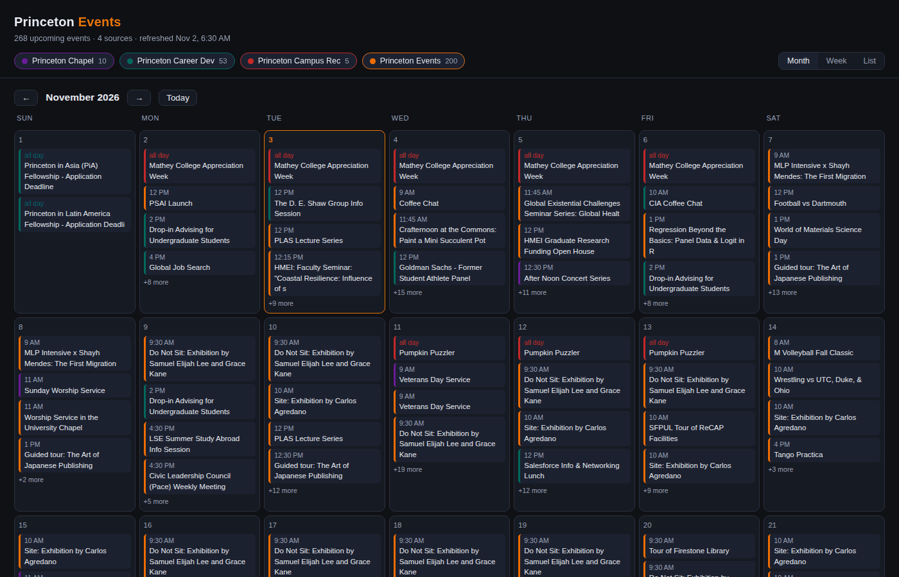
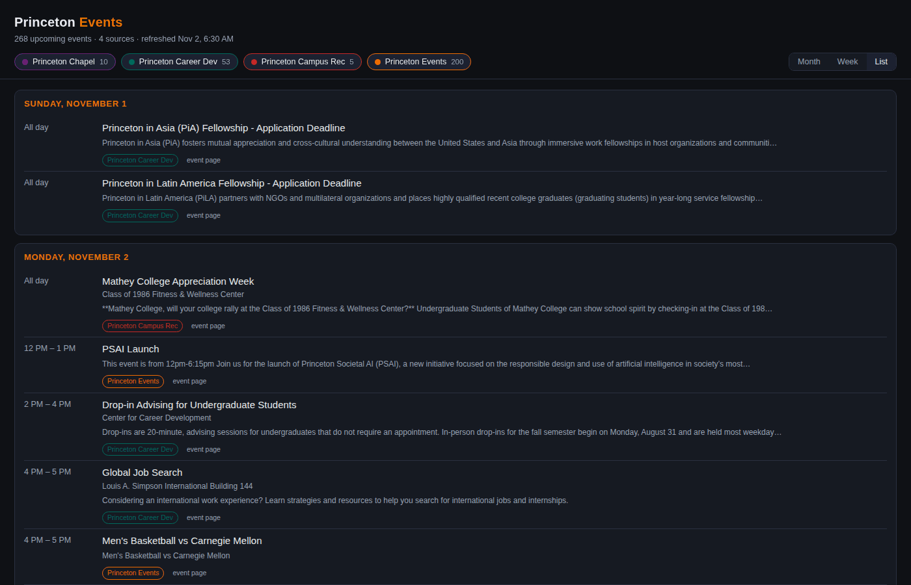

# Princeton Events (unofficial)

Princeton University's public event listings, republished as calendar feeds you can subscribe to and a calendar page you can browse. Refreshed every week. This is a student project, not a university service.

Browse: https://ik301.github.io/princeton-events/

## Subscribe

Copy a feed URL into your calendar app as a subscription. In Google Calendar: Other calendars, then **+**, then From URL. In Apple Calendar: File, then New Calendar Subscription.

| Feed | URL | Covers |
|---|---|---|
| Chapel | `https://ik301.github.io/princeton-events/chapel.ics` | Services and concerts at the University Chapel |
| Careers | `https://ik301.github.io/princeton-events/careers.ics` | Center for Career Development workshops, info sessions, employer coffee chats |
| Campus Rec | `https://ik301.github.io/princeton-events/campusrec.ics` | Recreation and fitness programming |
| University | `https://ik301.github.io/princeton-events/university.ics` | University-wide featured events |
| Everything | `https://ik301.github.io/princeton-events/all.ics` | All of the above combined |

Each feed is a separate subscription, so you can show or hide sources independently.

## What's in each entry

- Location: the venue, building and room.
- Description: the event's own blurb, plus `Audience:` (who it's open to) and `Register:` (a direct registration link where one exists, such as Handshake).
- URL: the event's page on the Princeton site, repeated in the description so every calendar client can reach it.

Details come from each event's own page, so a listing that says only "Recruiting 101, Sep 22" arrives with its room, audience and sign-up link.

## How it's built

An AI coding agent wrote the scraper (`scraper/princeton_events.py`, Python standard library only) to my spec. A scheduled job on my server runs it every Monday morning and commits the refreshed feeds and page here, and GitHub Pages serves them. Three of the department sites reject plain HTTP requests, so the job loads those pages in a headless browser; the university-wide listing is a plain RSS feed.

The scraper reads only public pages. `my.princeton.edu/events` sits behind Princeton's login and is left out on purpose.

## Layout

- `index.html`: a self-contained calendar page with month, week and list views and per-source toggles, built from the same data as the feeds. Deep-link with `?view=week` or `?view=list`, and `?date=YYYY-MM-DD` to open a given week or month.
- `*.ics`: the feeds above.
- `scraper/princeton_events.py`: the generator. It scrapes each source, parses the listings, and writes the `.ics` files and the page.

## Sources

- https://chapel.princeton.edu/events
- https://careerdevelopment.princeton.edu/advising-programs/workshops-events
- https://campusrec.princeton.edu/events
- https://www.princeton.edu/feed/events/

All event data belongs to Princeton University and the organizing departments; this repo reformats their public listings. Times are published in UTC. Every event has a stable ID, so refreshing a subscription updates events in place instead of duplicating them.

## Limitations

- The refresh is weekly, so a brand-new event can take up to a week to appear.
- Calendar apps cache subscriptions; Google can take several hours to pick up a change.
- Multi-day events and events with no listed time are published as all-day entries.

## License

The code is [MIT](LICENSE). The event data stays Princeton's.
